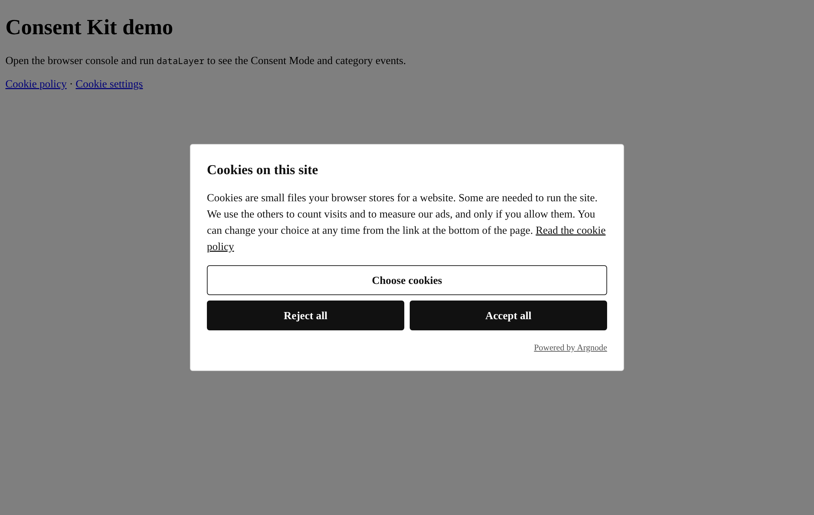
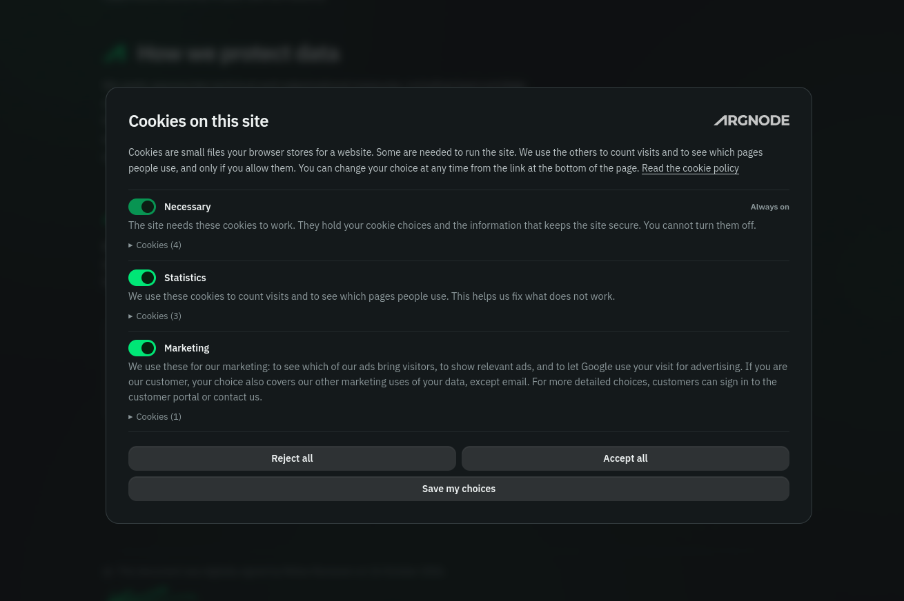

# Argnode Consent Kit (ACK)

Free, open-source, self-hosted consent management platform (CMP) with native Google Consent Mode v2.



Made by [Argnode Oy](https://www.argnode.com/?utm_source=github.com&utm_medium=referral&utm_campaign=evergreen-consent-kit&utm_content=readme).

Status: version 0.5.1, in production on [argnode.com](https://www.argnode.com/?utm_source=github.com&utm_medium=referral&utm_campaign=evergreen-consent-kit&utm_content=readme). The changes are in [CHANGELOG.md](CHANGELOG.md).

## Why ACK

- **You install it, you own it.** Free and open source (MPL-2.0), on your own server. No subscription, no fees per page view or domain, and no expired card can switch your banner off.
- **Made for the strict Finnish rules.** Designed against the cookie guidance of Traficom, the Finnish regulator, one of the strictest readings in the EU: equal Accept and Reject, nothing on before a choice, easy withdrawal.
- **No lost traffic sources.** The banner is a modal, so the visitor chooses on the landing page, where the ad click IDs, UTM tags and referrer are. A banner that visitors can ignore gets its "yes" on page two, and a paid click becomes "direct" traffic.
- **Google Consent Mode v2, done right.** The tool sets the consent default and then loads Google Tag Manager or the Google tag itself, so no Google tag can fire before consent.
- **Easy move from Cookie Information.** The dataLayer events have the same names, so the trigger logic of your other tags may need no changes.
- **Multi-language sites.** The banner follows the page language. English and Finnish are included.
- **One file for all cookie tables.** One `cookies.json` makes the tables in the banner and in your cookie policy. They never go out of step.
- **Policy pages without the banner.** Your cookie policy and privacy policy can be read before a choice.
- **Set up in minutes with AI.** A copy-paste prompt lets your AI assistant suggest a banner style from your site, interview you about your cookies and write your files.

## What ACK does not do

Read this before you choose ACK.

- **No cookie scanner.** The tool does not find your cookies. You list them once in `cookies.json` and keep the list up to date when you add or remove tools. The AI prompt in the install steps helps you make the first list.
- **No IAB TCF and no Google certification.** ACK is not registered in the IAB Europe Transparency & Consent Framework (TCF), which has a yearly fee, and it is not a Google-certified CMP. So it does not make a TCF consent string.
  - **Sites that sell ad space** with Google AdSense, Google Ad Manager or AdMob need a [Google-certified CMP](https://support.google.com/adsense/answer/13554116) to show personalised ads to visitors in the EEA, the UK and Switzerland. Without one, they can show only non-personalised or limited ads. For these sites, use a CMP from Google's certified list.
  - **Sites that buy ads** (Google Ads, GA4, and Floodlight tags for Display & Video 360, Campaign Manager 360 and Search Ads 360) work through Consent Mode v2. Ad tech that reads only the TCF consent string gets no consent from ACK.

## Features

### Consent that follows the rules
- A modal banner with three choices on the first layer: **Accept all**, **Reject all** and **Choose cookies**. Accept and Reject have the same size and style.
- Choices per category, with all non-necessary categories off by default. Each category shows a table of its cookies.
- Escape does not close the banner. Only a choice closes it.
- Withdrawal is as easy as consent: a footer link reopens the banner with the current choices. When a visitor withdraws, the tool deletes the first-party cookies of that category.
- The banner asks again when your cookie list changes, and after 12 months. Each stored consent holds a hash of the cookie list the visitor saw.
- Pages that you list, for example your cookie policy and privacy policy, open without the banner. A visitor can read them before a choice, and nothing is measured on them.

### Google Consent Mode v2
- All non-necessary signals are `denied` before any tag runs.
- The tool loads Google Tag Manager or the Google tag itself, after the consent default. So no Google tag can run before consent.
- URL passthrough and ads data redaction are on by default.
- One dataLayer event for each allowed category on every page load: `cookie_cat_functional`, `cookie_cat_statistic`, `cookie_cat_marketing`, `cookie_cat_unclassified`. These are the Cookie Information event names, so an existing GTM container may need no changes. An event is never pushed twice on one page view.

### One file drives everything
- `cookies.json` drives the banner, the cookie policy on your site and the consent version. They cannot go out of step.

### Light and self-hosted
- One script, no dependencies, about 11 kB gzipped. No server, no database, no account and no third-party requests of its own.
- Works with a strict Content Security Policy (`script-src 'self'`), with no inline script.
- Built on the native `<dialog>` element: keyboard use, focus and screen reader support come from the browser.
- Search, social and AI crawlers get no banner and no tags. The page content stays the same.
- The consent cookie is set on your main domain, so it is shared across subdomains. You can change this with `storage.domain`.

### Yours to change
- Change the look with CSS variables in your own `custom.css`.
- Change the texts in your own files. English and Finnish are included, and the banner follows the page language.
- Set up with AI: the prompt in the install steps writes your settings, cookie list and CSS.
- Attribution as a text link, a logo, or none.
- Connect your own systems (for example a CRM) with page options, dataLayer events and a small JavaScript API.
- `git pull` updates the tool and never changes your own files.

## Install

1. Clone this repository into your web root:

   ```bash
   cd public_html
   git clone https://github.com/argnode/argnode-consent-kit.git cmp
   ```

2. Block web access to the `cmp/.git/` folder. On Apache, the `.htaccess` in this repository does it. On nginx, add this to your server block:

   ```nginx
   location ~ /\.git { deny all; }
   ```

3. Copy the sample files and edit the copies:

   ```bash
   cp cmp/settings.sample.json cmp/settings.json
   cp cmp/cookies.sample.json cmp/cookies.json
   ```

   - In `settings.json`, set `loader.mode` (`gtm`, `gtag` or `none`) and your GTM or GA4 ID. Set `banner.policyUrl` to your cookie policy page. Put the paths of your cookie policy and privacy policy pages in `banner.exemptPaths` (for example `["/cookie-policy", "/privacy-policy"]`). These pages open without the banner, so a visitor can read them before a choice. Nothing is measured on them until the visitor chooses.
   - In `cookies.json`, list every cookie your site uses. Change `updated` to today's date (`dd.mm.yyyy`).

   **Faster: let an AI assistant make the files.** The tool cannot scan your site for cookies, so someone must list them. Copy this prompt into your AI assistant (for example Claude). It reads this repository, looks at your site and suggests a banner style that matches it, interviews you about your cookies and writes the files. Check the result before you go live.

   ````text
   You help me set up Argnode Consent Kit (ACK), a self-hosted cookie banner with
   Google Consent Mode v2: https://github.com/argnode/argnode-consent-kit

   1. Read README.md, settings.sample.json, cookies.sample.json, i18n/en.json and
      the CSS variables (--ack-*) at the top of ack.css in that repository.
   2. Interview me. Ask one short group of questions at a time:
      - Site address, languages, and the paths of my cookie policy and privacy
        policy pages.
      - Do I use Google Tag Manager or the Google tag (gtag.js)? The ID.
      - Every tool that can set cookies or send data: analytics, ad pixels
        (Google Ads, Meta, LinkedIn, TikTok...), heatmaps, chat widgets, video
        and map embeds, forms, A/B tests, logins, shops, payment.
      - Then ask me to accept all cookies on my site, open the browser developer
        tools (Application > Cookies, and Local storage), and paste the list.
        Ask again for anything that is not clear.
      - Do not ask me about the look. Open my site yourself and read its
        colours, fonts, corner radius, button style and if it is light or dark.
        Then suggest a banner style that matches, in a few short lines, and ask
        if I want it or want changes. If you cannot open my site, ask me for the
        colours and font instead.
   3. Write these files for me:
      - settings.json: from settings.sample.json. Set loader.mode and the ID,
        banner.policyUrl for each language, and banner.exemptPaths with the
        cookie policy and privacy policy paths.
      - cookies.json: from cookies.sample.json. Put each cookie in the correct
        category (necessary, functional, statistic, marketing, unclassified),
        with name, provider, domain, purpose, duration and setWhen in each of my
        languages. Keep ack_consent in necessary. Set "updated" to today
        (dd.mm.yyyy).
      - custom.css: the style that I accepted, as overrides of the --ack-*
        variables only. Accept all and Reject all must look the same, even if my
        site's own buttons have a primary and a secondary style.
      - i18n/custom/<language>.json and "customTexts", only if I want other
        texts.
   4. Rules:
      - Do not invent cookie names, durations or providers. If you do not know
        a value, write "[CHECK]" and tell me what to check.
      - Write plain, short sentences that a visitor understands.
      - At the end, list what I must do myself: remove my old GTM or Google tag
        snippet, add the script line and the "Cookie settings" link, keep a copy
        of every version of cookies.json, and have the texts checked. This is
        not legal advice.
   ````

4. **Remove your own GTM or Google tag snippet from your pages.** The tool loads it. If both exist, your snippet can run before the consent default.

5. Add this one line to every page, as early as possible in `<head>`:

   ```html
   <script async src="/cmp/ack.js"></script>
   ```

   The script is `async`, so the page does not wait for it. The script loads its own stylesheet. It finds its other files relative to its own address, so the folder can have any name.

6. Add a link to reopen the banner, for example in your footer:

   ```html
   <a href="#" data-ack-open>Cookie settings</a>
   ```

7. On your cookie policy page, add this element. The tool fills it with the cookie list:

   ```html
   <div data-ack-policy></div>
   ```

No inline script is necessary, so the tool works with a strict Content Security Policy (`script-src 'self'`). For GTM or GA4, add the Google hosts to your policy. Read "Content Security Policy" below.

## Update

```bash
cd public_html/cmp
git pull
```

A pull never changes your own files: `settings.json`, `cookies.json`, `custom.css` and `i18n/custom/`. They are in `.gitignore`.

If you do nothing after the clone, the tool uses the sample files. The banner works, but the cookie list is not your real list. The browser console shows a warning. Make your own `cookies.json` to be compliant.

## Subdomains

`settings.json` → `storage.domain` sets where the consent cookie is stored:

| Value | Effect |
|---|---|
| `auto` | The main domain, found automatically (for example `example.com` on `shop.example.com`). One choice covers all subdomains. This is the default. |
| `host` | Only the exact host. Each subdomain asks separately. |
| `example.com` | The domain that you give. |

For one choice across subdomains, install the tool on each subdomain with the same `cookies.json`. The consent is valid only for the cookie list that the visitor saw. If a subdomain has a different list, the visitor is asked again there. So list the cookies of all your subdomains in the one file.

## Keep old versions of cookies.json

**This is a compliance requirement.** Each stored consent contains a hash of the cookie list that the visitor saw. The hash is proof only if you still have the file that made it.

- Keep every version of `cookies.json`, for example in your site's own version control. Record the date each version went live.
- Keep each version for at least the date it was replaced plus `storage.maxAgeDays` (default 365 days). We recommend that you keep them always. The files contain no personal data.

This is not legal advice. Your own legal adviser sets the final period.

## Change the look

The banner works without any CSS of yours. To change it, set `"customCss": true` in `settings.json` and make `custom.css` in the same folder. Override the variables:

```css
.ack-banner, .ack-policy {
  --ack-bg: #14191b;
  --ack-fg: #edf1f1;
  --ack-button-bg: #00e676;
  --ack-button-fg: #06210f;
}
```

Accept and Reject use the same variables by default. Equal prominence is a compliance requirement. If you change one, change both.

This is the banner on [argnode.com](https://www.argnode.com/?utm_source=github.com&utm_medium=referral&utm_campaign=evergreen-consent-kit&utm_content=readme), with its own `custom.css` and the logo attribution:



All classes start with `ack-`. Nothing in `ack.css` targets elements outside `.ack-banner` and `.ack-policy`.

## Attribution

`settings.json` → `banner.attribution`:

| Value | Effect |
|---|---|
| `text` | A small "Powered by Argnode" link under the buttons. This is the default. |
| `logo` | The Argnode wordmark in the top-right corner of the banner. It is hidden on small screens. Set `attributionLogo` to `on-light` for a light banner or `on-dark` for a dark banner. |
| `none` | No attribution. |

## Page options

A script on your page can set `window.ackOptions` before `ack.js` loads. Use it to connect the banner to your own system, for example a CRM:

| Option | Effect |
|---|---|
| `consent` | Preset consent `{ c: { statistic: true } }`, or a Promise for it. The banner is not shown. |
| `consentTimeoutMs` | How long to wait for a `consent` Promise. Default 2000. |
| `hideCategories` | Category IDs not to show in the banner for this page view. |
| `beforeCategoryEvents(record)` | Runs after the Consent Mode update and before the category events. Push data that your tags need here. |

To save a choice in your own system, listen to `ack:consent` and use only events with `src: "banner"`. Do not save events with `src: "external"`: they came from your own system, and saving them again makes a loop.

## Change the texts

Default texts are in `i18n/<language>.json`. Do not edit them, because a pull overwrites them. Put only the keys that you change in `i18n/custom/<language>.json`, and add the language to `customTexts` in `settings.json`:

```json
{ "customTexts": ["fi"] }
```

## Content Security Policy

For Google Analytics 4 or GTM, add these hosts to your policy:

```
script-src  'self' https://www.googletagmanager.com
connect-src 'self' https://*.google-analytics.com https://analytics.google.com https://*.analytics.google.com https://www.googletagmanager.com https://www.google.com
img-src     'self' https://*.google-analytics.com https://www.googletagmanager.com
```

List `analytics.google.com` on its own. A wildcard matches subdomains only, and GA4 sends its hits to the bare host. `www.google.com` is the fallback endpoint.

If the GA4 property is linked to Google Ads with personalised advertising, or Google Signals is on, also add `https://*.g.doubleclick.net` to `connect-src` and `img-src`, and `https://www.google.com` to `img-src`. These requests are sent only for visitors who allow marketing. The audience pixel also goes to the visitor's country Google domain (`google.fi`, `google.se`, …). Add the domains of your main markets to `img-src`. A policy cannot list all of them.

Do not add `'unsafe-inline'`. The tool does not need it.

## For developers

| Call | Effect |
|---|---|
| `ack.open()` | Open the banner with the current choices. |
| `ack.getConsent()` | Return the current consent record, or `null`. |
| `ack.on('consent', fn)` | Run `fn(record)` when the consent is set or changed. |
| `ack.renderPolicy(selector)` | Render the cookie policy into the element. |
| `ack.reset()` | Delete the consent and show the banner again. For testing. |
| `ack.version` | Hash of the current cookie list. |

When the consent is set or changed, the tool also pushes `{ event: 'ack_consent_update', ack: { v, ts, c, src } }` to the dataLayer and dispatches the DOM event `ack:consent`. Use it to store consents in your own system, for example a CRM. The tool itself has no server and no database.

To give a consent from your own system (for example a CRM for a known user), push it before `ack.js` runs:

```js
dataLayer.push({ event: 'ack_external_consent',
  ack: { v: '<hash>', c: { statistic: true, marketing: false }, ts: 1760000000 } });
```

The tool uses it only if `v` is the current hash.

Demo pages are in [examples/](examples/). Serve the repository folder with any web server and open `examples/index.html`.

## Licence

This project uses the [Mozilla Public License 2.0](LICENSE) (MPL-2.0).

- You can use, copy and change this software. You can also use it commercially. This includes setting it up for your clients.
- If you change files of this project and distribute them, you must make the changed files available under MPL-2.0.
- Do not remove the copyright and licence notices from the files.
- You can combine this software with your own code. Your own separate files can use a different licence.

The licence does not give you rights to the Argnode name or logo. Read [TRADEMARKS.md](TRADEMARKS.md).

For a commercial licence without the MPL-2.0 obligations, contact [Argnode Oy](https://www.argnode.com/?utm_source=github.com&utm_medium=referral&utm_campaign=evergreen-consent-kit&utm_content=readme).

## Disclaimer

This software is provided "as is", without warranty of any kind. It is a best-effort tool. Argnode Oy is not liable for any damage that comes from its use. This includes lost data, lost tracking data, wrong attribution, wrong ad spend and lost revenue. Read sections 6 and 7 of the [licence](LICENSE).

This software and its documentation are not legal advice. Compliance statements in this project are design goals, not guarantees. You are responsible for the legal compliance of your website, your cookie definitions, your texts and your tracking setup. Speak to a legal professional if you are not sure.

## Contributing

Report bugs in [GitHub issues](https://github.com/argnode/argnode-consent-kit/issues) or by email to robot@argnode.com. To report a security problem, read [SECURITY.md](SECURITY.md). Do not open a public issue for it.

Read [CONTRIBUTING.md](CONTRIBUTING.md). You must accept the [Contributor License Agreement](CLA.md) before we can merge your contribution.
